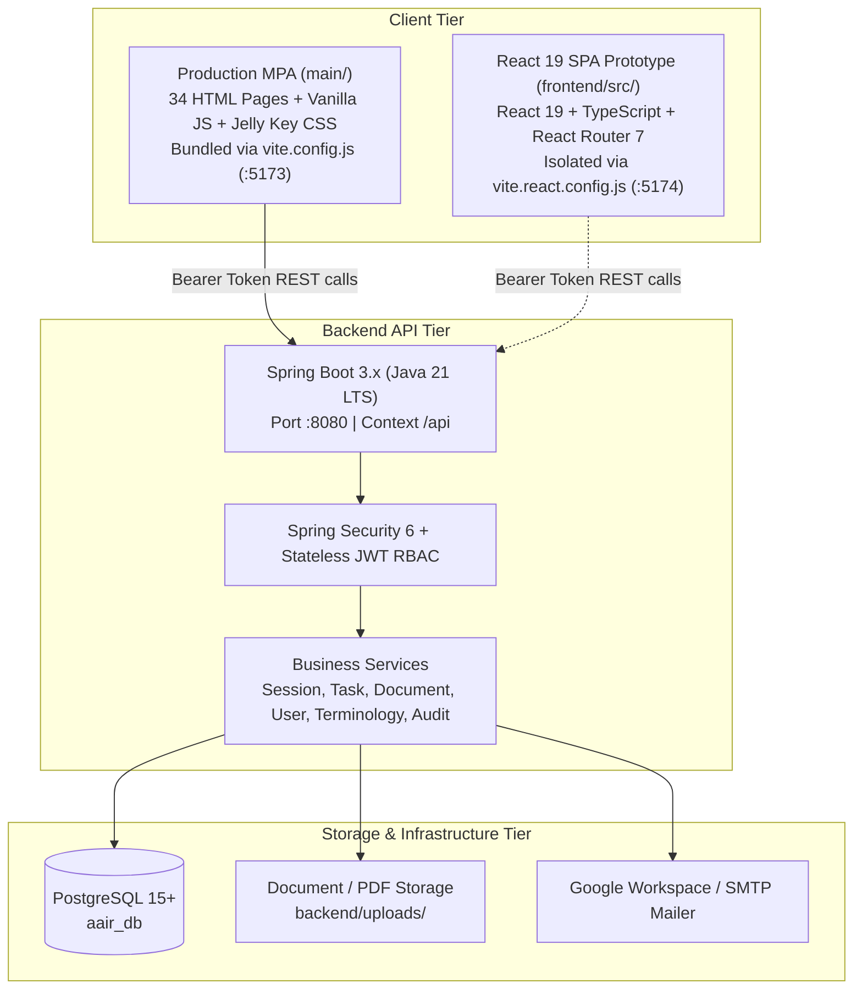

# AAIR Platform — System Architecture & Technical Blueprint

Tài liệu này quy chuẩn toàn bộ kiến trúc hệ thống, tổ chức mã nguồn, giải pháp xử lý nợ kiến trúc (Dual Architecture Debt) và lộ trình chuẩn hóa nền tảng **AAIR (Applied AI Research Laboratory)**.

---

## 1. Tổng quan Kiến trúc 3 Tầng (3-Tier Architecture)

Hệ thống AAIR được xây dựng theo mô hình phân tầng chặt chẽ giữa Giao diện người dùng, Tầng API nghiệp vụ, và Tầng lưu trữ dữ liệu:

---

## 2. Giải quyết Nợ kiến trúc (Dual Architecture Debt Resolution)

### 2.1. Thực trạng trước tối ưu
* Thư mục `main/` chứa toàn bộ 34 trang HTML/JS/CSS đa trang đang vận hành thực tế.
* Thư mục `frontend/src/` chứa mã nguồn React 19 (TypeScript, Tailwind, React Router) được khởi tạo dở dang nhưng bị bỏ rơi, không nằm trong luồng build của `vite.config.js`, gây nhầm lẫn về kiến trúc và cản trở việc bảo trì.

### 2.2. Chiến lược xử lý & Cô lập luồng Build
Hệ thống đã thiết lập cấu hình song song và cô lập hoàn toàn giữa 2 luồng:

| Luồng | Cấu hình | Cổng dev | Lệnh chạy | Output Build | Mục đích |
|---|---|---|---|---|---|
| **Production MPA** | `frontend/vite.config.js` | `5173` | `npm run dev` `npm run build` | `frontend/dist/` | Đóng gói toàn bộ 34 trang của hệ thống đang chạy chính thức |
| **React Prototype** | `frontend/vite.react.config.js` | `5174` | `npm run dev:react-prototype` `npm run build:react-prototype` | `frontend/dist-react/` | Môi trường thử nghiệm module hóa và chuyển đổi dần sang SPA |

* `.gitignore` đã bổ sung `frontend/dist-react/` để tránh đưa file build thử nghiệm vào git.
* Kiểm thử tự động `npm test` luôn bám sát và bảo vệ 100% chức năng của luồng MPA production.

---

## 3. Tiêu chuẩn Giao diện & Trải nghiệm (Jelly Key Design System)

Hệ thống tuân thủ nghiêm ngặt bộ tiêu chuẩn thiết kế Jelly Key:
1. **Bảng màu đồng nhất**:
   - `Primary Brand`: `#0099cc` (Normal), `#19a9d6` (Hover), `#008ab8` (Active / Selected).
   - `Header Gradient`: `linear-gradient(135deg, #0077a8 0%, #0099cc 50%, #00a8cc 100%)`.
   - `Action Button Accent`: Gradient xanh biển sâu `linear-gradient(135deg, #0d59c7 0%, #0099cc 100%)`.
2. **Skeleton Shimmer Loading**:
   - Thay thế hoàn toàn các thông báo `Loading tasks...` hay chữ tĩnh bằng component Skeleton chuyển động ánh sáng mượt mà (`.aair-skeleton-row`, `.aair-skeleton-shimmer-bar`, `keyframes: jellykey-skeleton-sweep`).
   - Tự động áp dụng trên các bảng biểu trung tâm: Tasks, Documents, Permissions, Users, Sessions.
3. **Phản hồi trạng thái (Feedback Loop)**:
   - Floating loading pill `.workspace-api-loading` hiển thị khi gửi các request ngầm.
   - Modal thông báo lỗi hoặc thành công theo chuẩn thiết kế không làm mất dữ liệu đã nhập trong form.

---

## 4. Bảo mật & Xác thực (Security Architecture)

1. **JWT Stateless Authentication**:
   - Access token mang thông tin danh tính và quyền hạn (`ROLE_ADMIN`, `ROLE_MANAGER`, `ROLE_AI_LABELER`, `ROLE_MANUAL_LABELER`, `ROLE_REVIEWER`, `ROLE_ANALYST`, `ROLE_TERMINOLOGY`).
   - Phiên đăng nhập được quản lý tại client qua `localStorage` và bảo vệ chuyển hướng tự động khi nhận HTTP 401.
2. **Atomic Workflows**:
   - Các nghiệp vụ tạo phiên (Session creation) được xử lý nguyên khối, rollback hoàn toàn nếu gặp lỗi và không sinh tác vụ rác.
3. **Audit Logging**:
   - Toàn bộ hành động quan trọng (đăng nhập, sửa nhãn, duyệt tài liệu, tạo người dùng) được ghi lại vào bảng `audit_logs`.
